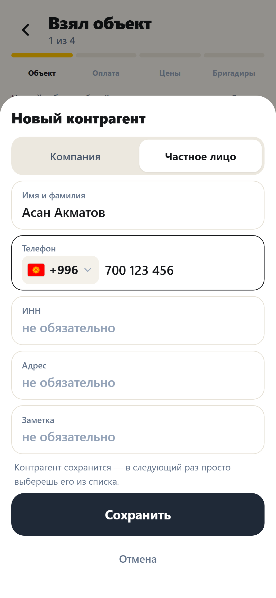
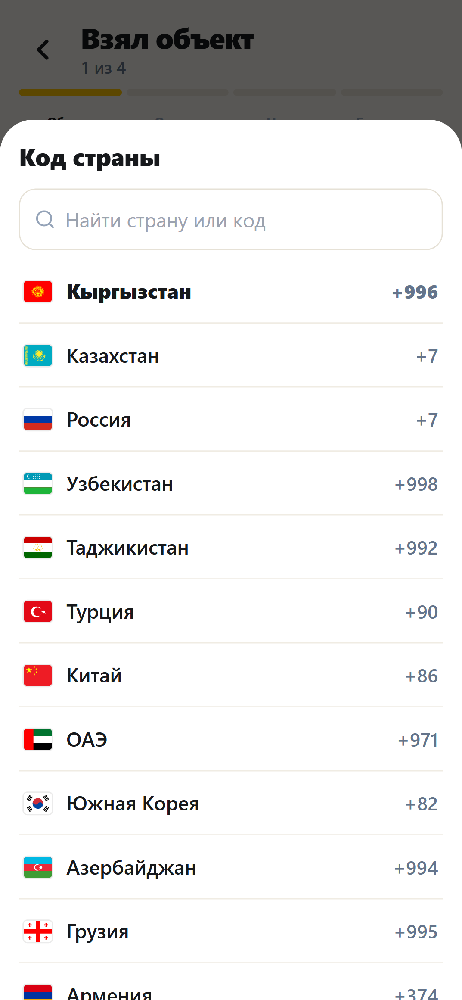
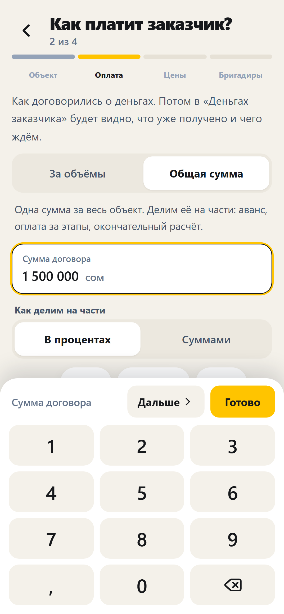
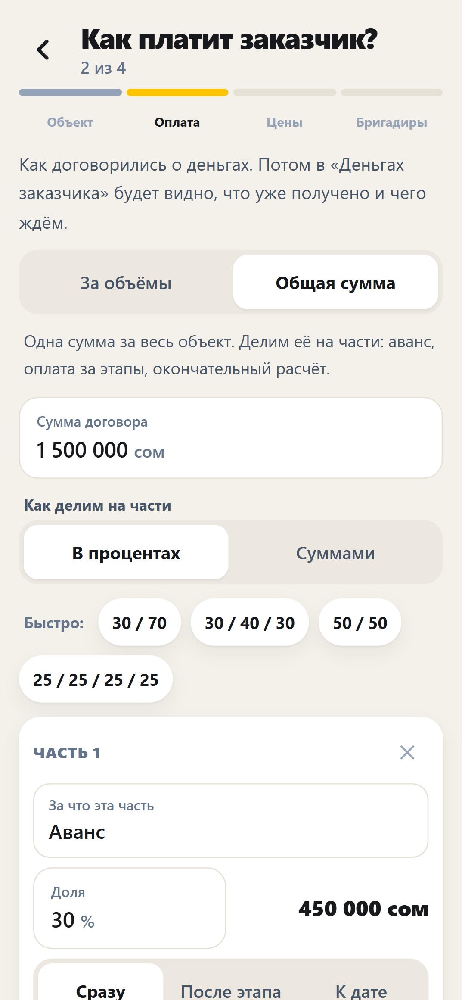
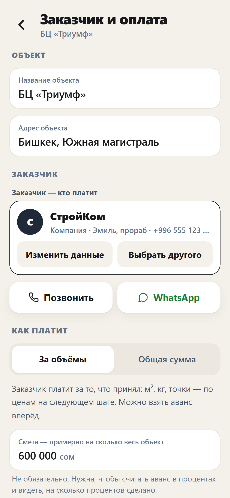
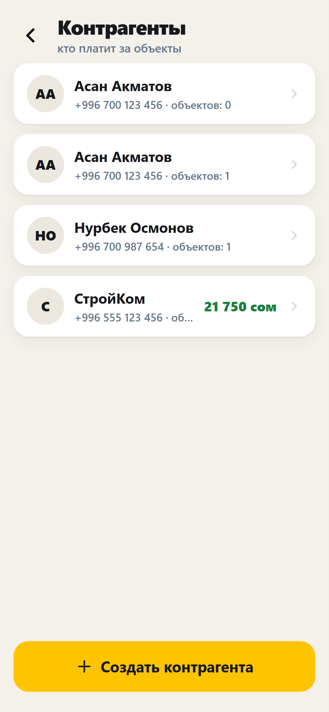
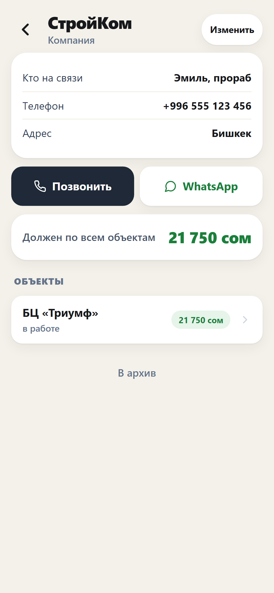

# Отчёт — версия 0.7.0

Сделано по замечаниям с телефона: заказчик теперь контрагент (выбрать или создать), телефон с флагом и +996, понятный блок оплаты с разбивкой суммы на части, цифры печатаются прямо в поле. Опубликовано на https://temirlan2994.github.io/brigadir/ — установленное приложение предложит обновиться само (или «Проверить обновления» в настройках).

## Что изменилось

1. **Цифры — прямо в поле.** Нажал на поле — оно подсвечивается с мигающим курсором, снизу выезжает крупная клавиатура без своего «табло». Старое число выделено: первая цифра заменяет его целиком, второй тап по полю — дописать. «Дальше» — к следующему полю (сумма договора → доля аванса → доля этапа…), «Готово» — убрать клавиатуру. Поле всегда прокручивается выше клавиатуры, шторки поднимаются над ней. На экранах «Выдал / Получил / Потратил» сумма — крупным полем сверху.
2. **Телефон.** Флаг 🇰🇬 и +996 уже стоят — номер пишется сразу после кода и сам делится на группы (555 123 456). Тап по флагу — другая страна (Казахстан, Россия, Узбекистан, Таджикистан, Турция, Китай, ОАЭ, Корея и др.). Вставили номер целиком («0555…», «+7 701…», «8 701…») — разберётся и сам выберет страну. Кнопка «из контактов» берёт номер и имя из телефонной книги (Android и приложение; на iPhone Safari этого не умеет).
3. **Заказчик = контрагент.** Две кнопки: «Выбрать контрагента» (список с поиском) и «Создать контрагента» — отдельное окно: компания или частное лицо, кто на связи, телефон, ИНН, адрес, заметка. Сохраняется — в следующий раз просто выбираешь. Вкладка «Объекты» → «Контрагенты»: список, карточка с «Позвонить» и «WhatsApp», его объекты и сколько он должен по всем.
4. **«Как платит заказчик» — вместо непонятных «Как платит» и «Аванс при старте».**
   - **За объёмы** — платит за принятые м², кг, точки. Смета (не обязательно), аванс: нет / в процентах от сметы / суммой — с объяснением, что аванс потом «отрабатывается». Как часто платит по актам.
   - **Общая сумма** — сумма договора делится на части **в процентах или суммами**, быстрые варианты 30/70, 30/40/30, 50/50, 4×25. У каждой части — название и когда платят: сразу (аванс), после этапа, к дате. Если не сходится — видно сколько не распределено, «Дальше» закрыт, кнопка «Добавить разницу в последнюю часть».
   - «Аванс уже получил» — сразу записывается в кассу.
   - Потом: в «Сдаче заказчику» кнопка «Этап сдан» — часть становится «к оплате», долг заказчика растёт; в «Деньгах заказчика» график: получено / к оплате / ждёт этапа / просрочено; в «Получил» подсказка «Ждём: Коробка — 600 000 сом» одним тапом; акт собирается по сданным этапам с реквизитами заказчика.
5. **Мастер нового объекта — 4 шага:** объект и заказчик → как платит → цены (столбцы «Заказчик / Бригаде», цена правится прямо в ячейке) → бригадиры с численностью. Внутри объекта «Заказчик и оплата» (всё сохраняется само) и «Цены за работы» — раздельно.
6. Мелочи по ходу: новый шаг мастера открывается сверху; строки лент не обрезают название из-за длинной метки («Наличные» вместо «Н…»); числа в настройках, у бригадира и в карточке записи — тоже прямо в поле.

## Проверено

- Юнит-тесты: 89 (ядро 100%, новые модули — телефоны и график оплаты).
- E2E: 25 из 25, из них 6 новых: телефон с кодом и сменой страны, повторный выбор контрагента, общая сумма 30/40/30 → аванс → «Этап сдан» → «Получил» по подсказке, несходящаяся разбивка, аванс в % от сметы, ввод цифр в поле с заменой старого значения.
- Руками в браузере на ширине телефона: весь мастер нового объекта с контрагентом и телефоном, оплата частями, цены в ячейках, бригадиры с численностью → «Сегодня» (касса 450 000, должен 0, не сдано 1 050 000) → «Этап сдан» → «Получил 600 000» → акт по этапам. Кыргызский язык на новых экранах.
- Старые данные: заказчики-текст сами превращаются в контрагентов при запуске (и после загрузки старой копии), телефоны приводятся к виду +996…

## Скриншоты

| | |
|---|---|
|  |  |
|  |  |
|  |  |
|  |  |
|  |  |
|  |  |
|  |  |
|  |  |

## Что не сделано или урезано

- «Из контактов» на iPhone не работает — ограничение Safari; номер вводится руками или вставкой.
- Список стран — 17 ближайших и популярных, без полного мирового справочника.
- Вечернее напоминание — по-прежнему подсказка внутри приложения (push без сервера в PWA невозможны).

## Что делать следующим

1. Обнови приложение и создай настоящий объект через новый мастер: заказчик из контактов, оплата частями.
2. Скажи, каких стран не хватает в списке кодов и какие ещё поля нужны контрагенту (например, расчётный счёт для актов).
