# Утренний отчёт

Готовый MVP «Бригадир»: блокнот бригадира, который сам считает деньги. Всё работает локально и офлайн, без сервера и регистрации.

## Как запустить

```bash
npm install
npm run dev
```

Открыть http://localhost:5173.

**На телефоне (та же сеть Wi-Fi):** `npm run dev -- --host` — в консоли появится адрес `http://192.168.x.x:5173`, открой его в Chrome на Android.

**Установка PWA на Android:** собери прод-версию `npm run build && npm run preview -- --host`, открой адрес на телефоне в Chrome → меню ⋮ → «Добавить на главный экран». После первой загрузки приложение работает без интернета, включая запись и правку данных.

Сценарий «Самат» руками — пошагово в [README.md](README.md), занимает две минуты.

## Что сделано

- **Главная** — три числа (Мне должны / Я должен рабочим / Свободно), красный баннер «Не хватает на зарплату», четыре большие кнопки, строка прибыли с разложением, лента последних 20 записей; каждое число раскрывается в список, из которого оно сложилось.
- **Мастер «Сделали работу»** — 4 шага по одному вопросу: плитки видов работ с избранным и «Как вчера» (повторяет последнюю запись за два нажатия), собственный нампад, мини-калькулятор площади с проёмами, цены из расценки объекта с «Запомнить», мультивыбор рабочих с делением Поровну / По сменам / Вручную, проверка с фото и заметкой.
- **Выдал рабочим** — выбор рабочего с балансом, «Выдать всё, что должен», Выплата / Аванс / Удержание, Наличные / Перевод.
- **Потратил** — 8 категорий плитками, «Кто платит: Я / Заказчик» (расходы заказчика в прибыль не входят), фото чека.
- **Получил от заказчика** — сумма, способ; приёмка работ чекбоксами; удержание / штраф / взаимозачёт заказчика.
- **Рабочие** — карточки с балансом и словом («должен ему» / «перебор аванса» / «в расчёте»); карточка: Начислено / Выдано / Удержано / Осталось, история, «Выдать», «Выписка» (WhatsApp по номеру или копирование в буфер), архив.
- **Работы** — записи по дням с фильтрами (объект, вид, статус), карточка записи: правка через новую версию, мягкое удаление с «Отменить», приёмка, история версий.
- **Деньги** — касса, поступления, расходы, прибыль с разложением; фильтры по объекту и периоду; экспорт CSV (5 файлов, UTF-8 BOM, «;»); акт выполненных работ на печать.
- **Настройки** — объекты, виды работ (избранное, порядок, свои виды с пиктограммой), расценки объекта, язык RU/KY, налог (нет / процент / фикс в месяц), начальный остаток кассы, резервная копия JSON (экспорт/импорт), «Загрузить пример», «Удалить все данные» с вводом слова.
- **Ядро** — все деньги в тыйынах (целые числа), снимок цен на момент записи, журнал только с добавлением (версии + мягкое удаление), балансы всегда считаются из записей. 36 юнит-тестов, покрытие src/core 100%, все контрольные примеры ТЗ сходятся до тыйына.
- **PWA и офлайн** — service worker, манифест, иконки; e2e-тест: отключение сети → перезагрузка → запись работы → сеть вернулась → данные на месте.
- **e2e (Playwright, 390×844)** — сценарий «Самат» целиком, «Как вчера», перезагрузка, офлайн, экспорт → удаление → импорт, отсутствие горизонтального скролла на 360 и 430, скриншоты всех экранов.

## Что не сделано или урезано

- Виртуализации длинных списков нет — лента ограничена 20 записями, «Работы» — пагинация «Показать ещё» по 50 строк. На объёмах MVP хватает.
- В карточке выдачи/расхода/поступления правятся сумма, дата и заметка; категория/тип/способ — нет (проще удалить и записать заново, удаление с «Отменить»).
- Порядок видов работ — стрелками, перетаскивания нет (на телефоне стрелки надёжнее).
- Выписка рабочему — всегда на русском, независимо от языка интерфейса.
- «Свой период» в Деньгах — два поля дат под переключателем, отдельной кнопки «Свой» нет.
- Печать акта проверена вёрсткой (таблица 13 px, на A4 входит ~25–30 строк), на физическом принтере не проверялась.

## Известные баги и шероховатости

- Слово «сом» в суммах не переводится (на кыргызском пишется так же).
- Тост «Записано · Отменить» 5 секунд перекрывает нижнюю часть экрана — нажать под ним в это время нельзя.
- Если нажать «Скачать JSON» в ту же секунду, что и «Загрузить пример», копия может быть неполной (загрузка демо идёт ~1 с).
- Адреса экранов с решёткой (`#/work/new`) — плата за работу на любом статическом хостинге.
- Названия работ на кыргызском — черновой перевод, нужен носитель языка.

## Решения, которые стоит пересмотреть (из DECISIONS.md)

1. **«Мне должны» считается по активному объекту, а касса и «Я должен рабочим» — по всем объектам.** Если объектов несколько, возможно, захочется переключатель «по объекту / по всем» прямо на главной.
2. **Деление остатка тыйынов** — метод наибольших остатков (так требуют контрольные примеры ТЗ), а не «первым в списке» из текста ТЗ. Разница — один тыйын.
3. **Демо задаёт начальный остаток кассы 150 000 сом** — иначе «Свободно» не положительное. У реального пользователя остаток 0, пока он не введёт свой в настройках.
4. **HashRouter** — ради GitHub Pages и офлайна. Если деплой будет на Vercel/Netlify, можно перейти на обычные адреса.
5. **Кыргызские названия видов работ** в справочнике («Кыш кынуу», «Шыбоо», «Кара жумушчу») — проверить с носителем.

## Скриншоты

| | |
|---|---|
|  | 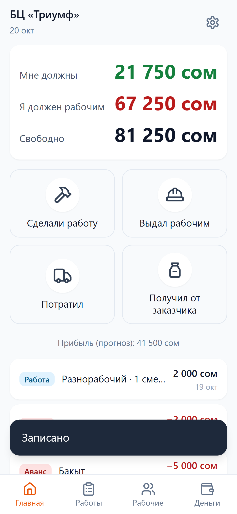 |
| 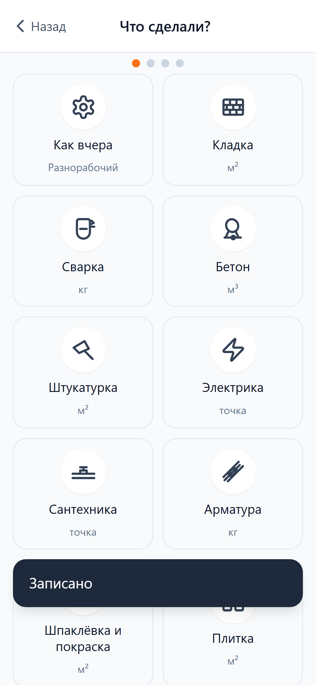 | 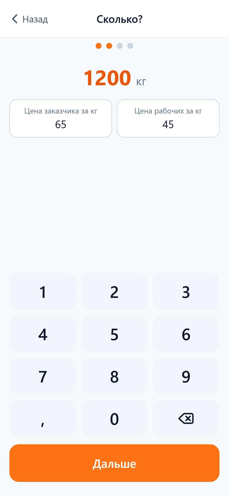 |
| 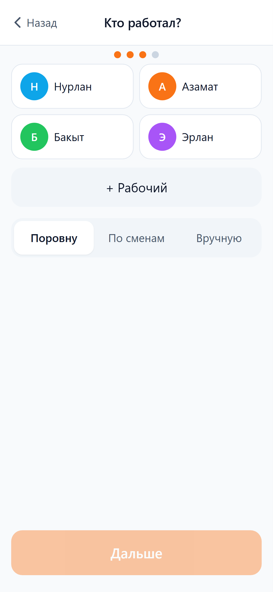 | 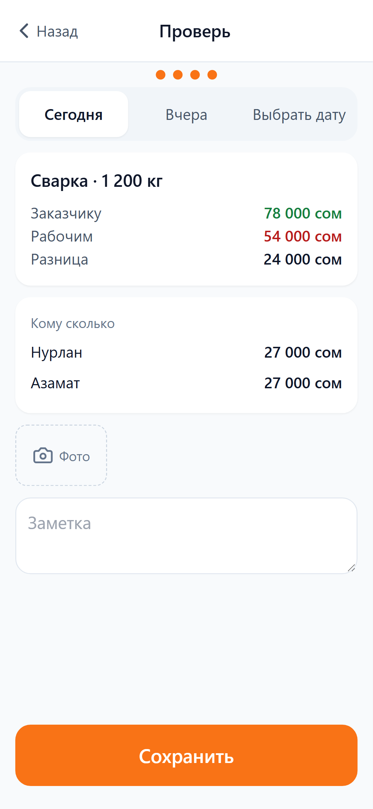 |
| 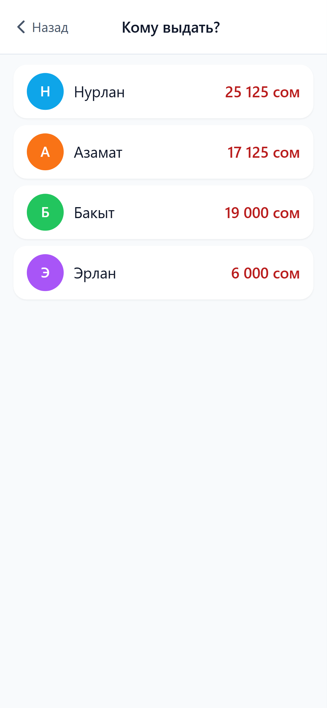 | 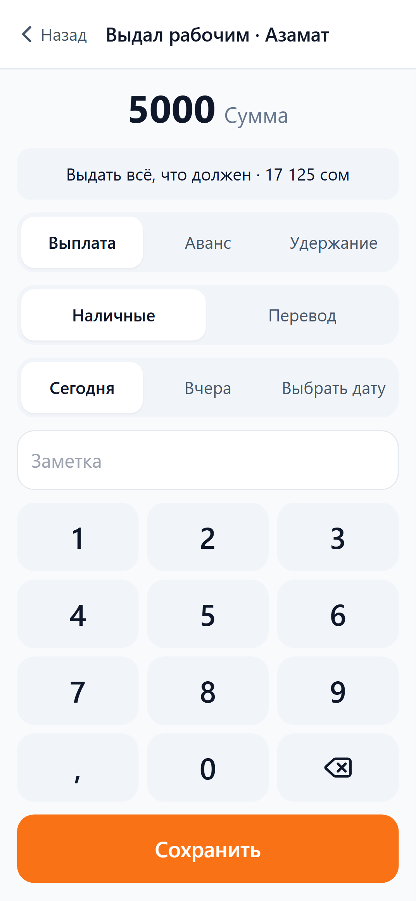 |
| 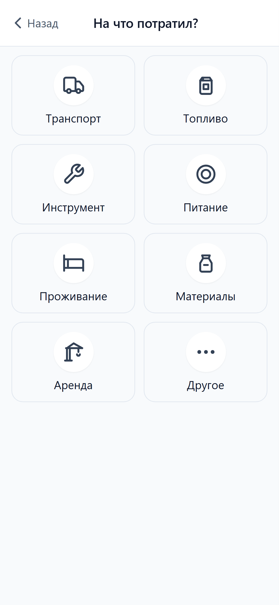 | 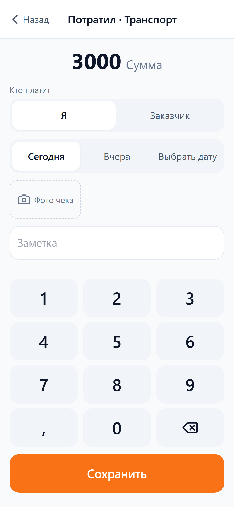 |
| 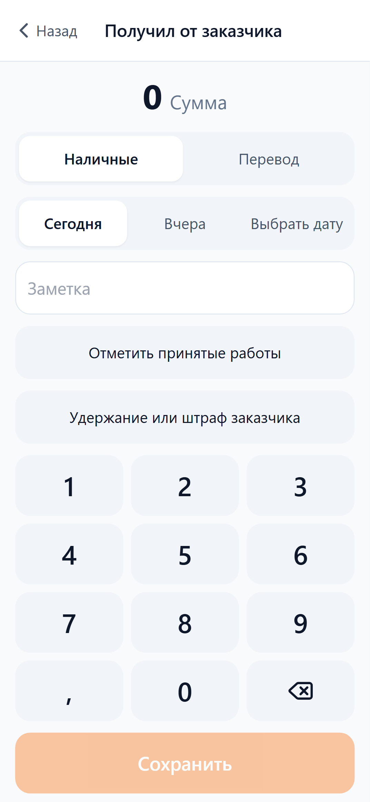 | 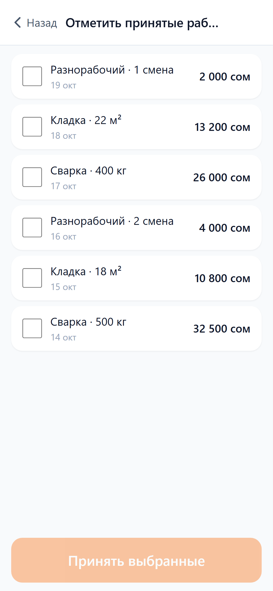 |
| 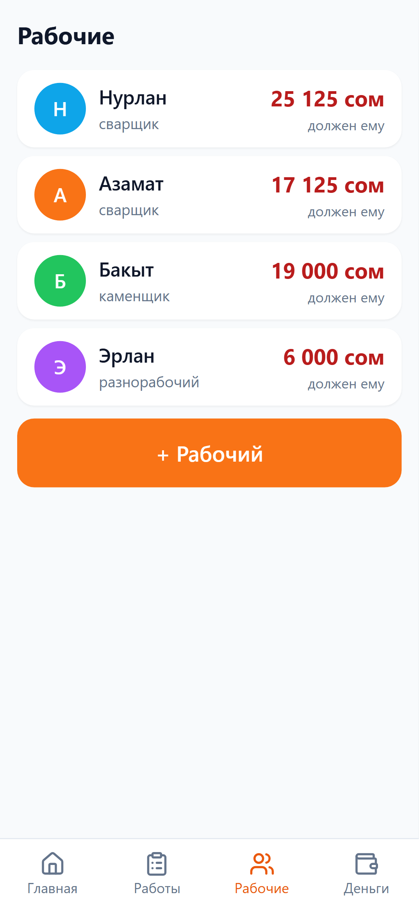 | 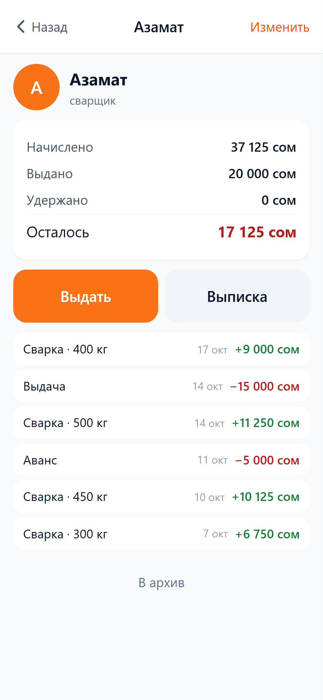 |
| 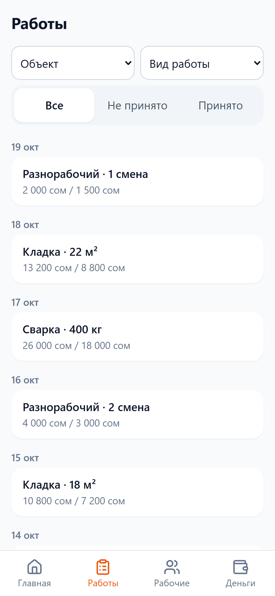 | 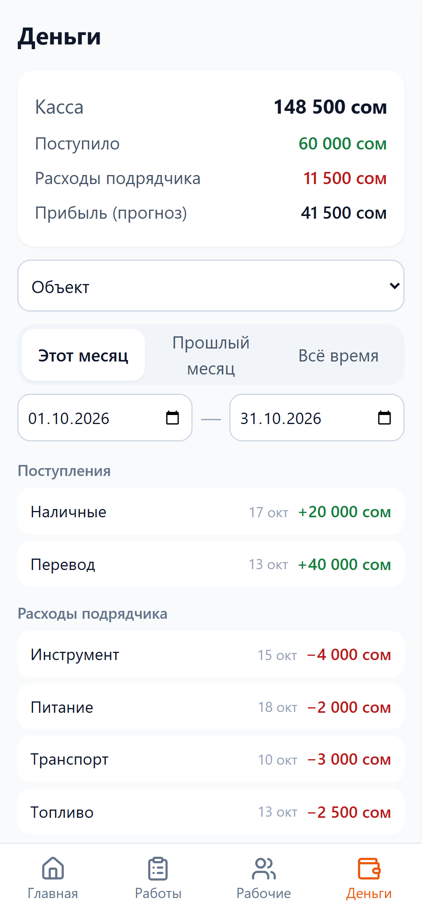 |
| 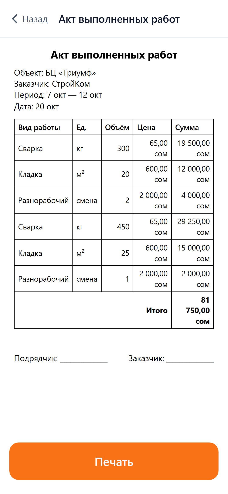 | 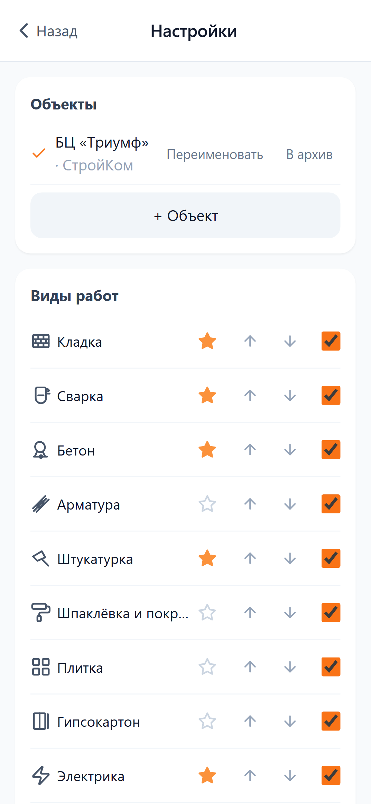 |

## Что делать следующим

1. Проверить на реальном объекте Самата: неделя вечерних записей, записать, где он спотыкается — особенно мастер и «Как вчера».
2. Пересмотреть кыргызский словарь и названия работ с носителем языка, поправить расценки справочника под реальные цены.
3. Задеплоить `dist/` на Vercel или Netlify и установить PWA на телефон Самата, чтобы не зависеть от ноутбука.
4. Приучить к резервной копии: раз в неделю «Скачать JSON» (можно добавить напоминание в приложении).
5. Дальше по списку «не сегодня» из ТЗ: табель посещаемости, учёт материалов, калькуляторы металла и кирпича — только после того, как главный цикл приживётся.
